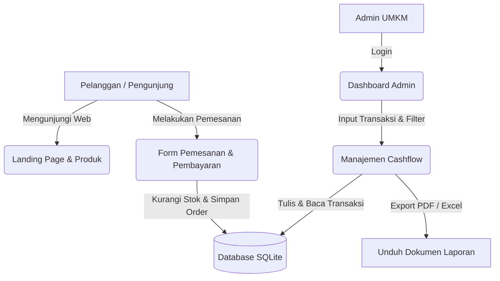

# 💼 Sistem Informasi UMKM: Katalog Produk, Pemesanan, & Manajemen Cashflow Pintar

Selamat datang di repositori resmi **Sistem Informasi UMKM & Cashflow Pintar**. Aplikasi ini dibangun khusus untuk memberdayakan pelaku Usaha Mikro, Kecil, dan Menengah (UMKM) dalam mengelola kehadiran digital mereka, mempermudah transaksi pemesanan pelanggan, serta mengotomatisasi pencatatan dan pelaporan keuangan secara real-time.

Aplikasi ini menggunakan perpaduan teknologi tangguh **Laravel 12** di sisi backend dan **React 19** di sisi frontend yang dihubungkan secara harmonis menggunakan **Inertia.js 2.0**, menghasilkan pengalaman aplikasi Single Page Application (SPA) yang cepat, interaktif, dan modern.

---

## 🎯 Fitur Utama Aplikasi

### 1. 🌐 Landing Page & Testimoni Pelanggan
*   **Halaman Utama Dinamis (`Welcome.jsx`)**: Menampilkan representasi digital bisnis UMKM secara estetik.
*   **Sistem Testimoni Interaktif**: Menampilkan ulasan pelanggan terbaru.
*   **Form Umpan Balik Instan**: Pengunjung dapat memberikan ulasan secara langsung yang secara dinamis masuk ke database setelah melalui proses validasi data.

### 📦 2. Katalog Produk Interaktif
*   **Grid Produk (`Product/Index.jsx`)**: Menampilkan daftar produk lengkap dengan gambar, deskripsi ringkas, harga terformat Rupiah, dan status stok aktual.
*   **Detail Produk (`Product/Show.jsx`)**: Halaman detail yang menyajikan deskripsi lengkap produk serta tombol **"Beli Sekarang"** yang terhubung langsung dengan sistem pemesanan.

### 🛒 3. Sistem Pemesanan & Alamat Geolokasi
*   **Formulir Pemesanan Modern (`Order.jsx`)**: Pelanggan dapat memasukkan detail nama, kontak WhatsApp, memilih beberapa produk sekaligus beserta kuantitasnya, serta menyertakan catatan tambahan.
*   **Peta Pengantaran**: Dilengkapi dengan koordinat pengiriman (`delivery_latitude`, `delivery_longitude`, `delivery_address`) untuk akurasi pengantaran pesanan.
*   **Halaman Sukses & Integrasi Pembayaran (`OrderSuccess.jsx`)**: Setelah memesan, pelanggan disuguhkan ringkasan pesanan dan metode pembayaran digital seperti **QRIS** (berupa gambar scan) atau **Transfer Bank** sesuai pengaturan profil UMKM (`UmkmPaymentDetail`).

### 📊 4. Panel Admin & Manajemen Cashflow (Arus Kas)
*   **Pencatatan Keuangan Presisi (`Admin/Cashflow.jsx`)**: Admin dapat mencatat setiap arus dana masuk (`inflow`) maupun arus dana keluar (`outflow`).
*   **Ringkasan Keuangan Otomatis**: Menampilkan akumulasi total pemasukan, total pengeluaran, serta keuntungan bersih (Net Cashflow) secara instan.
*   **Filter Tanggal Fleksibel**: Memungkinkan pencarian data transaksi dalam periode tanggal tertentu.
*   **Ekspor Dokumen**:
    *   📄 **Ekspor PDF**: Menghasilkan dokumen laporan keuangan formal siap cetak menggunakan template Blade via *DomPDF*.
    *   📊 **Ekspor Excel**: Menghasilkan berkas spreadsheet laporan keuangan lengkap menggunakan *PhpSpreadsheet*.

---

## 🛠️ Stack Teknologi

Aplikasi ini mengadopsi arsitektur monolitik modern yang memisahkan tanggung jawab UI dan Data secara bersih:

| Komponen | Teknologi | Deskripsi |
| :--- | :--- | :--- |
| **Backend Framework** | Laravel v12.x | Menyediakan API internal, routing, database ORM, autentikasi, dan business logic. |
| **Frontend Framework** | React v19.x | Mengelola tampilan antarmuka pengguna yang reaktif dan dinamis. |
| **Bridge** | Inertia.js v2.0 | Menghubungkan Laravel & React tanpa perlu membangun REST API terpisah secara manual. |
| **Database** | SQLite | Database bawaan yang ringan, portabel, dan tidak memerlukan konfigurasi server tambahan. |
| **Styling** | Tailwind CSS v4 | Framework utility-first CSS generasi terbaru untuk antarmuka yang modern, responsif, dan premium. |
| **Icons & UI Elements** | Lucide React & Radix UI | Set ikon modern dan pustaka komponen primitif yang aksesibel. |
| **Report PDF Generator** | Barryvdh DomPDF | Library rendering template HTML/CSS menjadi berkas PDF berkualitas tinggi. |
| **Report Excel Generator**| PhpSpreadsheet | Library manipulasi spreadsheet untuk membuat laporan berekstensi `.xlsx`. |

---

## 📐 Arsitektur Sistem

Aplikasi ini menggunakan alur data terintegrasi berikut:



---

## 📁 Struktur Direktori Penting

Berikut adalah beberapa berkas dan direktori utama yang membangun aplikasi ini:

```bash
hackathon/
├── app/
│   ├── Http/
│   │   └── Controllers/
│   │       ├── CashflowController.php   # Logika bisnis transaksi, filter, & ekspor laporan
│   │       ├── OrderController.php      # Logika pemesanan, pengurangan stok, & pembayaran
│   │       ├── ProductController.php    # Logika tampilan katalog & detail produk
│   │       └── TestimonialController.php# Logika ulasan pelanggan di halaman utama
│   └── Models/
│       ├── Order.php                    # Model data pesanan pelanggan (JSON cast)
│       ├── Product.php                  # Model data produk (nama, harga, stok, gambar)
│       ├── Testimonial.php              # Model testimoni pembeli
│       ├── Transaction.php              # Model transaksi arus kas (inflow/outflow)
│       ├── Umkm.php                     # Model profil informasi pelaku UMKM
│       └── UmkmPaymentDetail.php        # Model detail pembayaran QRIS & Bank Transfer
├── database/
│   ├── migrations/                      # Skema tabel database (Users, Orders, Cashflows, dll)
│   └── seeders/                         # Data uji/awal untuk pengisian cepat database
├── resources/
│   ├── js/
│   │   ├── Components/                  # Komponen React yang reusable (misal: TestimonialsSection)
│   │   ├── Layouts/                     # Tata letak global (Authenticated & Guest layouts)
│   │   └── Pages/                       # Halaman visual aplikasi (React)
│   │       ├── Admin/
│   │       │   └── Cashflow.jsx         # UI manajemen keuangan & pencetakan laporan admin
│   │       ├── Product/
│   │       │   ├── Index.jsx            # UI daftar katalog produk UMKM
│   │       │   └── Show.jsx             # UI detail produk & formulir pembelian instan
│   │       ├── Welcome.jsx              # Landing page utama + form testimoni pelanggan
│   │       ├── Order.jsx                # Form pemesanan barang dengan detail alamat
│   │       └── OrderSuccess.jsx         # Halaman penyelesaian pesanan & instruksi bayar
│   └── views/
│       ├── app.blade.php                # Entrypoint template HTML Laravel
│       └── reports/
│           └── cashflow_php.blade.php   # Layout HTML/CSS untuk cetak PDF laporan keuangan
├── routes/
│   ├── web.php                          # Deklarasi rute aplikasi Inertia & rute ekspor dokumen
│   └── auth.php                         # Rute autentikasi admin/user bawaan Laravel Starter Kit
└── vite.config.ts                       # Konfigurasi bundling aset dengan Vite
```

---

## 🚀 Panduan Instalasi & Menjalankan Aplikasi

Ikuti langkah-langkah di bawah ini untuk memasang aplikasi di lingkungan lokal Anda (Windows/macOS/Linux):

### 📋 Prasyarat Sistem
Pastikan perangkat Anda sudah terpasang:
*   **PHP >= 8.2** (pastikan ekstensi `sqlite3`, `mbstring`, `openssl`, dan `xml` aktif di `php.ini`)
*   **Composer** (pengelola dependensi PHP)
*   **Node.js >= 18** & **npm** (pengelola dependensi JavaScript)

---

### 📥 Langkah-Langkah Pemasangan

#### 1. Clone & Masuk ke Direktori Proyek
Salin proyek ke komputer lokal Anda dan masuk ke dalam foldernya:
```powershell
cd "d:\PROJECT LATAGON\hackathon"
```

#### 2. Pasang Dependensi Backend (PHP Composer)
Unduh seluruh library backend yang diperlukan:
```bash
composer install
```

#### 3. Pasang Dependensi Frontend (Node.js npm)
Unduh seluruh paket JavaScript yang diperlukan untuk React & Vite:
```bash
npm install
```

#### 4. Konfigurasi File Lingkungan (`.env`)
Salin file konfigurasi lingkungan dari template default:
```powershell
copy .env.example .env
```
Buka file `.env` yang baru dibuat dan pastikan pengaturan database diarahkan ke SQLite:
```ini
DB_CONNECTION=sqlite
# Laravel otomatis akan mencari file database/database.sqlite
```

#### 5. Generate Kunci Keamanan Aplikasi
```bash
php artisan key:generate
```

#### 6. Buat Database & Jalankan Migrasi
Buat berkas database SQLite kosong di dalam folder `database` jika belum tersedia:
```powershell
# Di Windows PowerShell:
New-Item -Path "database" -Name "database.sqlite" -ItemType "file" -Force
```
Jalankan migrasi database untuk membangun tabel beserta data seeder awal:
```bash
php artisan migrate --seed
```

#### 7. Jalankan Server Pengembangan (Development Server)
Untuk kemudahan, proyek ini dikonfigurasi dengan script runner paralel menggunakan `concurrently`. Anda hanya perlu menjalankan satu perintah untuk menyalakan Laravel server, antrean antarmuka (queue listener), dan bundler Vite sekaligus:
```bash
composer dev
```
Atau jika Anda ingin menjalankannya secara terpisah di tab terminal berbeda:
*   **Terminal 1 (Laravel Server):** `php artisan serve`
*   **Terminal 2 (Vite Compiler):** `npm run dev`

Buka browser Anda dan akses aplikasi di alamat: [http://127.0.0.1:8000](http://127.0.0.1:8000).

---

## 📌 Pengujian & Autentikasi Admin
Untuk masuk ke panel admin (misalnya untuk mengelola Cashflow di `/admin/cashflow`), Anda harus login terlebih dahulu. Gunakan data default berikut yang dihasilkan oleh Seeder database:

*   **URL Login**: [http://127.0.0.1:8000/login](http://127.0.0.1:8000/login)
*   **Email**: `test@example.com`
*   **Password**: `password` (atau password default sesuai pengaturan pabrik Laravel Starter Kit)

---

## 💡 Troubleshooting (Masalah Umum)

1. **Error: `Database file does not exist`**
   Pastikan Anda telah membuat file kosong `database.sqlite` di dalam direktori `database/` sebelum menjalankan `php artisan migrate`.

2. **Error: `Mix/Vite manifest not found`**
   Terjadi karena aset frontend belum di-compile. Pastikan Anda menjalankan `npm run dev` selama masa pengembangan, atau `npm run build` jika ingin melakukan deployment.

3. **Error: Ekstensi GD/Zip/XML Hilang saat install Excel/PDF**
   Instalasi `phpoffice/phpspreadsheet` membutuhkan beberapa ekstensi PHP aktif. Buka `php.ini` Anda, cari baris `;extension=gd` atau `;extension=zip`, lalu hapus tanda titik koma (`;`) di depannya untuk mengaktifkan, kemudian restart server PHP Anda.
